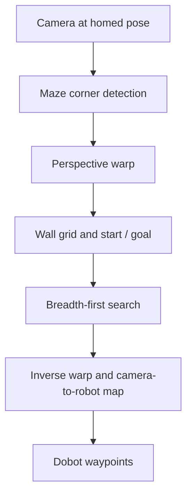
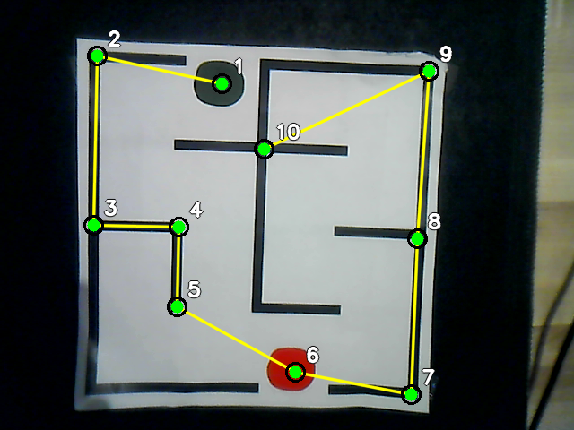
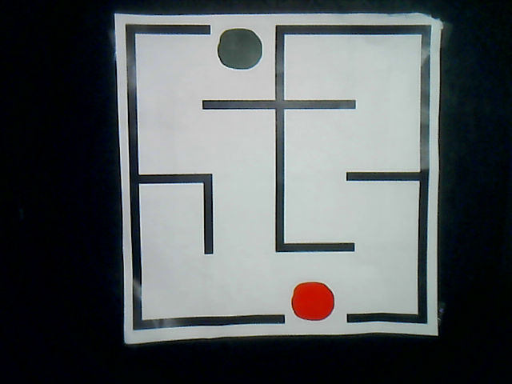
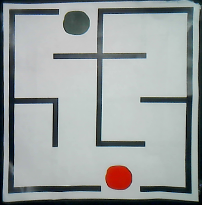
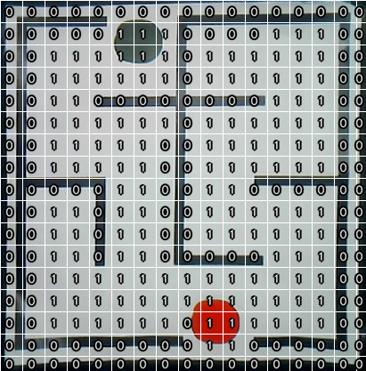
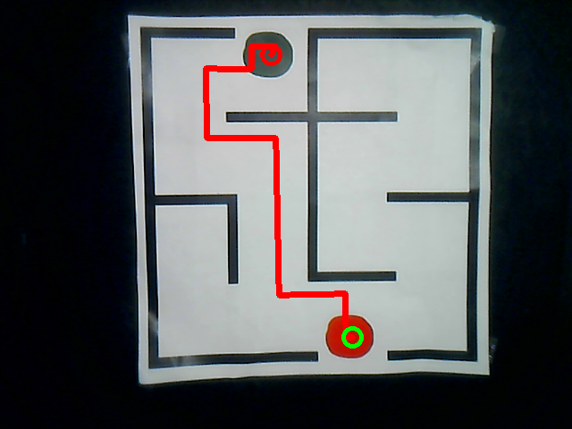

# Vision-Guided Maze Arm

> A Dobot Magician Lite uses one camera image, a camera-to-robot calibration, and BFS to plan a path through a physical maze and trace it with the arm.

**Python · OpenCV · Dobot Magician Lite · Computer Vision · BFS**

## Demo

[](https://youtu.be/RCkUjKmtlLw)

**[Watch the autonomous maze solver →](https://youtu.be/RCkUjKmtlLw)**

The video shows the full physical pipeline. The arm starts from a known pose, the maze is imaged once, and the Dobot traces the computed path on the hardware.

## System Overview



The arm looks once from a fixed home pose, turns that image into a traversable grid, and follows the planned waypoints open-loop. Perception, planning, and motion stay in separate stages so each coordinate conversion can be checked before the robot moves.

Red is the start. Green is the goal.

## From Camera to Robot

### 1. Calibrate

Ten clicked image points are paired with the arm pose at those physical locations. `cv2.estimateAffine2D` fits a 2×3 map from camera pixels to robot X, Y. On the hardware, commanded calibration points landed within about 20–30 mm of the targets. The calibration script also fits a homography. Execution uses the affine map, stored and reused while the camera stays at the same home pose.



### 2. Perceive

From the homed pose the camera frames the maze on a black mat. The largest bright quadrilateral is the maze boundary. Its corners are ordered top-left, top-right, bottom-right, bottom-left, expanded slightly outward, and used to warp the sheet into an axis-aligned rectangle. Hough circles and HSV classification find the red start and green goal. An Otsu wall mask marks the black walls. Each 25×25 pixel cell is blocked when at least 10% of its pixels are wall.

### 3. Plan

The warped maze is a 4-connected grid. Free cells are 1 and blocked cells are 0. A breadth-first search written in this repository finds the shortest path from the cell nearest the red marker to the cell nearest the green marker. Start and goal cells stay traversable even when the marker covers wall pixels. The saved example is a 17×17 grid and a 22-move path.

### 4. Transform

The path is a polyline in the warped image: start marker, cell centers, goal marker. An inverse perspective transform sends those points back to the original camera image. The calibration map then converts each camera pixel into robot X, Y. Z stays at a fixed drawing height of -35 mm.

### 5. Execute

`pydobot` connects over `/dev/ttyACM0` and sends one `move_to` per waypoint, with a one-second pause between points. The arm follows that discrete path at a fixed height and wrist angle. Motion is open-loop after the single photo.

## Vision Pipeline

| Camera frame | Rectified maze |
|---|---|
|  |  |





## Results

| Evaluation | Result |
|---|---:|
| Camera-to-robot calibration | Within 20–30 mm of the calibration targets |
| Maze configurations tested | 4 |
| Physical test runs | About 12 (3 per maze) |
| Saved example | 17×17 grid, 22 moves |

The trial counts are from the project report. This repository includes one complete example: the capture, the grid, and the path the arm executed.

Inside the calibrated workspace the arm completed the computed path. Mazes placed toward the edge of the frame ran into joint limits, and the end-effector camera can meet the sheet when the maze extends outside the reachable area. During testing the maze was kept centered. Automatic workspace limits are described as future work in the report.

## Engineering Takeaways

- The affine calibration is the link between a pixel path and a command the arm can execute. Without that map, the planner stays in the image.
- Wall pixels have to become a discrete grid before search is meaningful. The 10% cell rule is what turns a noisy mask into free and blocked cells.
- Classical vision settings moved with the lighting. The green HSV range had to be widened, and the Hough circle threshold had to be lowered, before both markers stayed stable across mazes.
- A shortest grid path is only useful inside the arm’s reachable workspace. The planner and the joint limits are one system.

## Project Structure

**Calibration.** Collect pixel and robot pairs, fit the map, then replay points.

- `run_calibration.sh`
- `part_1_camera_caliberation/open_camera.py`
- `part_1_camera_caliberation/get_pixel_cordinates.py`
- `part_1_camera_caliberation/robot_motion.py`
- `part_1_camera_caliberation/Affine_transform.py`
- `part_1_camera_caliberation/camera_utilities.py`

**Vision.** Capture, warp, and detect markers and walls.

- `part_2_maze_solution/01_capture_image.py`
- `part_2_maze_solution/02_maze_warp_from_json.py`
- `part_2_maze_solution/03_maze_circles_and_grid.py`

**Planning.** BFS on the traversability grid.

- `part_2_maze_solution/04_solve_maze.py`

**Robot control.** Map the path into robot coordinates and trace it.

- `part_2_maze_solution/05_unwrap_and_overlay_path.py`
- `part_1_camera_caliberation/Maze_Motion.py`
- `part_1_camera_caliberation/robot_utilities.py`
- `run_part2_all.sh` runs capture, vision, planning, unwarp, and motion in order.

The low-level Dobot move and home helpers follow earlier course exercises on driving the arm. Marker classification, the wall grid, and BFS were completed inside the maze-solving starter outlines, which still contain the original prompts. Corner detection, warping, the calibration fit, the camera-to-robot conversion, and the run scripts are the integration built for this project. OpenCV, NumPy, Pillow, and pydobot are third-party libraries.

## Running the Project

```bash
python -m venv .venv
source .venv/bin/activate
pip install -r requirements.txt
```

**Saved example, no robot and no camera.** From the repository root:

```bash
python part_2_maze_solution/02_maze_warp_from_json.py
python part_2_maze_solution/03_maze_circles_and_grid.py
python part_2_maze_solution/04_solve_maze.py
python part_2_maze_solution/05_unwrap_and_overlay_path.py
```

These rewrite the warped image, grid, path overlay, and unwarped path already checked in.

**Full system.** This needs a Dobot Magician Lite on `/dev/ttyACM0`, a webcam, and the physical maze on the black mat.

```bash
./run_calibration.sh
./run_part2_all.sh --cam-index 0
```

`run_calibration.sh` is interactive. It homes the arm, opens a preview, records clicked pixels, and records arm poses when you position the arm and press `a`. Paste the printed `img_pts` and `rob_xy` into `Affine_transform.py`. Paste the printed `M` matrix into `Maze_Motion.py`.

`run_part2_all.sh` homes the arm, captures a frame, runs the vision and planning stages, and traces `part_2_maze_solution/solution_path_points_unwarped.json`. Pass the camera index that sees the maze. The calibration preview scripts use camera index 1. Change that constant in `open_camera.py` and `get_pixel_cordinates.py` if the preview is the wrong device.

## Technical Report

**[Read the Full Project Report](docs/RAS545_Project1_Report.pdf)**

The report contains the methodology, figures, and discussion of the physical trials.

## Course Context

Arizona State University  
RAS 545: Robotics Systems I  
Fall 2025

Individual project.
